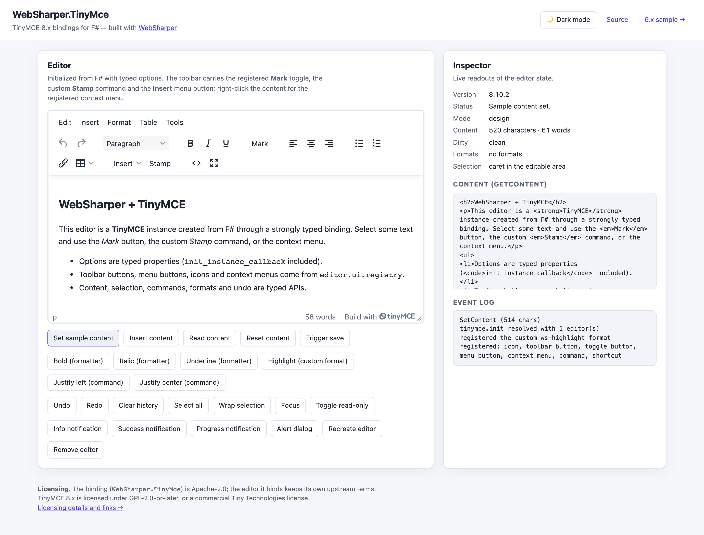

# WebSharper.TinyMce

[TinyMCE](https://www.tiny.cloud/) bindings for WebSharper — a strongly typed,
npm-based binding for the classic WYSIWYG editor, generated from TinyMCE's own
TypeScript declarations.

[](https://www.nuget.org/packages/WebSharper.TinyMce)

> **Two packages, two upstream lines.** This repository ships
> **`WebSharper.TinyMce`** for **TinyMCE 8.x** (GPL-2.0-or-later or a commercial
> Tiny Technologies license) and **`WebSharper.TinyMce6`** for **TinyMCE 6.x**
> (MIT). See [Licensing](#licensing-and-the-upstream-library) before you pick
> one; the 6.x binding has its own notes in [TINYMCE6.md](TINYMCE6.md).

## Live demos

**Try it live:** [Open the sample in your browser](https://dotnet-websharper.github.io/tinymce/)



The sample doubles as the binding's [test case](#running-the-test-case): it
initializes an editor from F#, drives the options, the `editor.ui.registry`
(toolbar button, toggle button, menu button, icon, context menu), the formatter
(built-in and custom formats), commands, shortcuts, selection, undo, options,
notifications, dialogs, modes and the editor lifecycle.

The **6.x** sample is deployed alongside it at
[`/v6/`](https://dotnet-websharper.github.io/tinymce/v6/):


## Projects

| Project | Target | Purpose |
|---|---|---|
| `TinyMceCommon` | `netstandard2.0` | The shared WIG definition (one surface, generated twice) |
| `WebSharper.TinyMce` | `netstandard2.0` | Binding for TinyMCE 8.x (`WebSharper.TinyMce` namespace) |
| `WebSharper.TinyMce6` | `netstandard2.0` | Binding for TinyMCE 6.x (`WebSharper.TinyMce6` namespace) |
| `WebSharper.TinyMce.Sample` | static SPA | The 8.x sample (WebSharper.UI + esbuild) |
| `WebSharper.TinyMce6.Sample` | static SPA | The 6.x sample, built into `dist/v6` |

The two bindings share `TinyMceCommon/Definition.fs`, which is parameterized by
the upstream line; only the members and options that actually differ between 6.x
and 8.x are generated conditionally. Both can even be referenced side by side,
because they live in different namespaces.

## Install

```sh
dotnet add package WebSharper.TinyMce    # TinyMCE 8.x
dotnet add package WebSharper.TinyMce6   # TinyMCE 6.x (MIT)
```

The binding imports the editor from the **npm** package (`import tinymce from
"tinymce"`), so add TinyMCE to your front-end dependencies and let your bundler
include it:

```sh
npm install tinymce
```

The binding's `.fsproj` declares `tinymce` as an npm dependency with an
inclusive lower and an exclusive next-major upper bound (`>= 8.10.2 < 9.0.0` for
8.x, `>= 6.8.6 < 7.0.0` for 6.x).

## Usage

```fsharp
open WebSharper
open WebSharper.JavaScript
open WebSharper.TinyMce

[<SPAEntryPoint>]
let Main () =
    let options = EditorOptions()
    options.Target <- JS.Document.QuerySelector("#editor") |> As<HTMLElement>
    options.Height <- 420
    options.Plugins <- "lists link code table wordcount"
    options.Toolbar <-
        "undo redo | blocks | bold italic underline | bullist numlist | link table | code"
    options.Toolbar_mode <- ToolbarMode.Wrap
    options.Skin <- false          // the skin CSS is bundled by the app
    options.Suffix <- ""
    options.Content_css <- false
    options.Content_style <- "body { font-family: system-ui, sans-serif; }"
    options.License_key <- "gpl"   // TinyMCE 8.x: accept the GPL terms (or pass your commercial key)
    options.Init_instance_callback <- (fun editor ->
        // `editor.formatter` only exists once the editor is initialized.
        editor.Formatter.Register("highlight", highlightFormat))
    options.Setup <- (fun editor ->
        // The UI registry is available in `setup`.
        let spec = ToolbarButtonSpec()
        spec.Type <- "button"
        spec.Text <- "Stamp"
        spec.Tooltip <- "Insert a timestamp"
        spec.OnAction <- (fun _ -> editor.InsertContent("<em>stamped</em>"))
        editor.Ui.Registry.AddButton("stamp", spec)
        editor.AddCommand("stamp", fun _ -> editor.InsertContent("<em>stamped</em>")))

    TinyMCE.Init(options).Then(fun editors ->
        let editor = editors.[0]
        editor.OnChangeTyped(fun _ -> console.log editor.GetContent())))
```

The surface follows the upstream API closely:

- **Options** are typed properties on `EditorOptions`. WIG capitalizes the
  property names but keeps the JavaScript keys, so `Init_instance_callback` sets
  `init_instance_callback`, `Content_css` sets `content_css`, and so on. Closed
  sets of string values are enums (`ToolbarMode.Wrap`, `ToolbarLocation.Top`,
  `EntityEncoding.Numeric`, `NotificationType.Success`, …).
- **Editor state** is strongly typed: `editor.Selection`, `editor.UndoManager`,
  `editor.Formatter`, `editor.EditorCommands`, `editor.Mode`, `editor.Options`,
  `editor.Ui.Registry`, `editor.WindowManager`, `editor.NotificationManager`,
  `editor.Dom`, `editor.Shortcuts`.
- **Events** are available both by name (`editor.On("NodeChange", fun e -> …)`)
  and with typed payloads (`OnChangeTyped`, `OnSetContentTyped`,
  `OnExecCommandTyped`, `OnUndoTyped`, `OnSwitchModeTyped`, …).
- **The global** is `TinyMCE`: `Init`, `Get`, `Get(id)`, `Get()`,
  `ActiveEditor`, `MajorVersion`/`MinorVersion`, `TriggerSave`, `Remove`,
  `PluginManager`, `ScriptLoader`, `DOM`.

### Notes and limitations

- **Records/maps are `obj`.** Options whose upstream type is a JavaScript
  `Record<…>` (`menu`, `formats`, `attributes`, `external_plugins`, …) are typed
  `obj`; build them with `[<Inline "({ … })">] let attrs : obj = X<obj>` in your
  own code. Everything that has a concrete shape (options, specs, events,
  selections, formats, notifications) is typed.
- **Command values are `obj`.** `editor.ExecCommand(cmd, ui, value)` and command
  callbacks take `obj` because upstream types the value as `any`.
- **Dialogs.** `windowManager.alert`/`confirm` are bound; `windowManager.open`
  with a full dialog body is not modelled (the dialog spec is a large union of
  component types).
- **Menu items fetched at runtime need an explicit type.** TinyMCE 8 resolves
  menu item types from the registry; when you build `MenuItemSpec` objects in a
  `fetch` callback, set `Type <- "menuitem"`.
- **Callbacks are delegates.** `onSetup` returns a teardown `System.Action`;
  when you need a nested function, construct it explicitly
  (`System.Func<_,_>(fun api -> System.Action(fun () -> …))`).
- **The 8.x binding needs a license key.** TinyMCE 7+ runs in "no key" mode
  unless you set `license_key`. Set `License_key <- "gpl"` to accept the GPL
  terms, or pass your commercial key.
- **The sample's editor keeps TinyMCE's light Oxide skin** in both page themes:
  skins are separate stylesheets, so the page theme and the editor skin are
  independent (the 6.x/8.x samples are light-themed by default with a page-wide
  light/dark switcher).

### Migrating from the 3.x-era binding

The old binding (up to 4.7.x) modelled the TinyMCE **3.5** API: `tinymce.ui.*`
control classes, `theme_advanced_*` options, `Dispatcher.onXxx`, the
`ControlManager`/`WindowManager.Alert` surface, and a **Formlets** editor layer.

- The `tinymce.ui.*` control classes, `theme_advanced_*` options and the
  `ControlManager` no longer exist upstream; they are gone from the binding.
  Toolbar and menu UI is now built through `editor.ui.registry`
  (`AddButton`, `AddToggleButton`, `AddMenuButton`, `AddContextMenu`, `AddIcon`,
  `AddSidebar`, …).
- Options lost their `theme_advanced_*` prefixes (`Toolbar`, `Toolbar_mode`,
  `Menubar`, `Plugins`, …), and `TinyMCEConfiguration` is now `EditorOptions`.
- The `WebSharper.Formlets.TinyMce` project is **removed**: it depended on
  `WebSharper.Formlets`, `WebSharper.Html` and `WebSharper.Reactive`, which were
  never published past WebSharper 4.7 and cannot build on the current line. The
  SPA sample replaces the old Html test project.

## Licensing and the upstream library

The binding is the project's own work and is **Apache-2.0** (see
[LICENSE.md](LICENSE.md)). The editor it binds keeps **its own license**, and
that license is *not* Apache-2.0:

| Package | Upstream | License |
|---|---|---|
| `WebSharper.TinyMce` | TinyMCE 8.x | **GPL-2.0-or-later** or the **Tiny Self-Hosted / commercial** license |
| `WebSharper.TinyMce6` | TinyMCE 6.x | **MIT** (the last MIT line) |

For the 8.x line, TinyMCE's `license.md` states that the software is licensed
under the GNU General Public License version 2 or later **or** the Tiny
Technologies Software Terms & Conditions of Use (the Tiny Self-Hosted License
Agreement), unless you have signed a negotiated commercial license.

- Upstream license: <https://github.com/tinymce/tinymce/blob/main/LICENSE.md>
- Tiny's licensing page: <https://about.tiny.cloud/legal/>
- npm package: <https://www.npmjs.com/package/tinymce>

**What this means for consumers of the binding:**

- The binding's own code is Apache-2.0, but **the editor you ship is GPL-2.0+ or
  commercially licensed**. Choosing the `WebSharper.TinyMce` package does not
  change the terms of the TinyMCE library your application bundles.
- Under the GPL option you must comply with the GPL when you distribute the
  editor: TinyMCE 8 requires an explicit acknowledgement at initialization —
  `license_key: 'gpl'` (the binding's `License_key <- "gpl"`) — and the Tiny
  branding stays visible. AGPL-style network copyleft does not apply (GPLv2 is
  not AGPL), but distributing a closed-source application that bundles a GPL
  library is not permitted without the commercial option.
- Tiny's commercial option is the **Tiny Self-Hosted License Agreement** (paid);
  pass your key with `License_key` instead of `'gpl'`.
- If you need a permissive upstream license, use the **`WebSharper.TinyMce6`**
  package, which binds TinyMCE 6.8.6 — the last MIT-licensed release. Its
  license text: <https://github.com/tinymce/tinymce/blob/6.8.6/license.txt>.
- Keep the upstream copyright/notice lines when you bundle the npm package in a
  built artifact (`dist/` in the samples does exactly that).

Historical context: TinyMCE 4.x and 5.x were LGPL-2.1, 6.x was MIT, and 7.x
switched to GPL-2.0-or-later (or commercial).

## Running the test case

The samples are static SPA bundles in `dist/`:

```sh
dotnet build WebSharper.TinyMce.Sample/WebSharper.TinyMce.Sample.fsproj -c Release
dotnet build WebSharper.TinyMce6.Sample/WebSharper.TinyMce6.Sample.fsproj -c Release

dotnet tool install -g dotnet-serve   # once
dotnet serve -d dist -p 8080
```

- `http://localhost:8080/` — the 8.x sample.
- `http://localhost:8080/v6/` — the 6.x sample.

Each sample bundles its own copy of the matching `tinymce` version with esbuild
(the WebSharper output is imported by a small generated entry that also loads
the theme, model, icons and plugins, and exposes the instance as the global
TinyMCE's UMD modules expect).

## Build from source

```sh
dotnet tool restore
dotnet paket install
dotnet build WebSharper.TinyMce.sln -c Release
```

The binding and Extensions-style definition target `netstandard2.0`; the samples
are static SPA bundles. Building a sample also runs `npm install` and esbuild.

## Pack

```sh
./build WS-Package            # or: WSPackageFolder=/tmp/pkg dotnet fsi ./build.fsx -t WS-Package
```

`paket pack` reads **both** templates in `nuget/` and produces
`WebSharper.TinyMce.<version>.nupkg` and `WebSharper.TinyMce6.<version>.nupkg`.

## Deployment

`.github/workflows/ghpages.yml` builds both samples in Release on the default
branch and publishes `dist/` to GitHub Pages (`gh-pages` branch). The 8.x sample
is at the site root, the 6.x sample at `/v6/`.

## Repository layout

```
TinyMceCommon/                  shared WIG definition (parameterized by version)
WebSharper.TinyMce/             binding for TinyMCE 8.x
WebSharper.TinyMce6/            binding for TinyMCE 6.x
Sample/                         shared sample sources (Client.fs, index.html, site.css, esbuild config)
WebSharper.TinyMce.Sample/      8.x sample project -> dist/
WebSharper.TinyMce6.Sample/     6.x sample project -> dist/v6/
nuget/                          the two paket templates
docs/                           sample screenshots
```

## License

The bindings, samples and build files in this repository are licensed under the
**Apache License, Version 2.0** — see [LICENSE.md](LICENSE.md). The upstream
editor is a separate work with its own terms; see
[Licensing and the upstream library](#licensing-and-the-upstream-library).