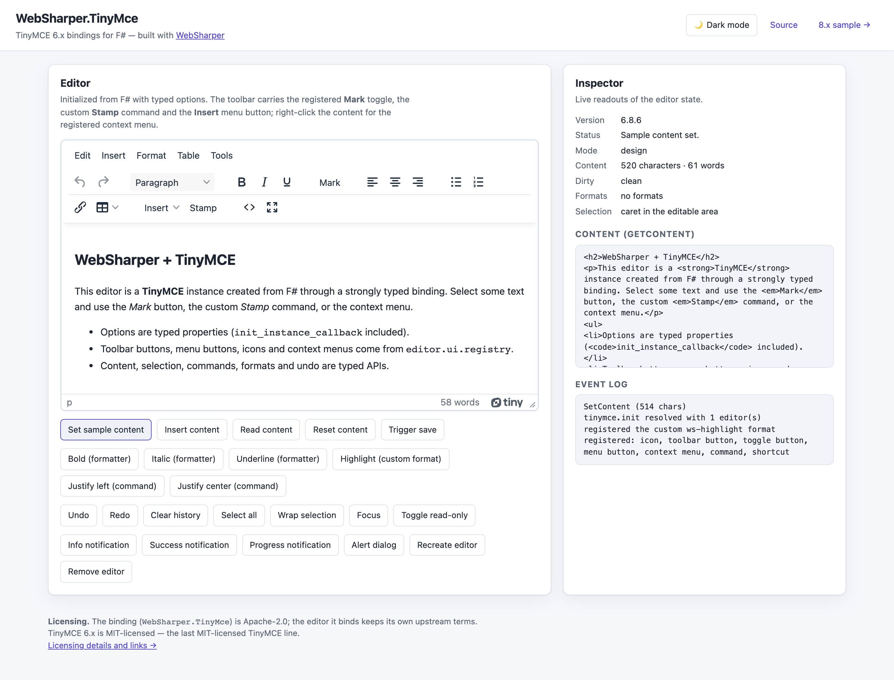

# WebSharper.TinyMce6

[TinyMCE](https://www.tiny.cloud/) **6.x** bindings for WebSharper — the last
**MIT-licensed** TinyMCE line, packaged separately from the 8.x binding so you
can pick the upstream terms you want to ship.

[](https://www.nuget.org/packages/WebSharper.TinyMce6)

> The main binding in this repository, **`WebSharper.TinyMce`**, targets
> **TinyMCE 8.x**, which is **GPL-2.0-or-later or a commercial Tiny Technologies
> license**. Both packages are generated from the same shared WIG definition; see
> the [main README](README.md) for the full API notes, the sample walkthrough and
> the build instructions.

## Why a second package?

TinyMCE changed its license over the years — 4.x/5.x were LGPL-2.1, **6.x was
MIT**, and 7.x switched to GPL-2.0-or-later (or a paid commercial license).

Binding the 6.x line under its own package id and namespace means:

- `WebSharper.TinyMce` stays on the current upstream (8.x) without forcing a
  license change on existing consumers;
- `WebSharper.TinyMce6` gives you an **MIT** editor with the same typed surface,
  if MIT matters for your distribution;
- both live in different namespaces (`WebSharper.TinyMce6` vs
  `WebSharper.TinyMce`), so a project can even reference both.

## Live demo

**Try it live:** [Open the 6.x sample in your browser](https://dotnet-websharper.github.io/tinymce/v6/)



The sample is the 6.x twin of the [main sample](https://dotnet-websharper.github.io/tinymce/):
same F# sources, compiled against this binding (the differences are the missing
`license_key` option and one extra 6.x option, see below).

## Install

```sh
dotnet add package WebSharper.TinyMce6
npm install tinymce@6
```

The binding imports the editor from the npm package (`import tinymce from
"tinymce"`) and declares `tinymce` as `>= 6.8.6 < 7.0.0` in its `.fsproj`.

## Usage

```fsharp
open WebSharper
open WebSharper.JavaScript
open WebSharper.TinyMce6

[<SPAEntryPoint>]
let Main () =
    let options = EditorOptions()
    options.Target <- JS.Document.QuerySelector("#editor") |> As<HTMLElement>
    options.Plugins <- "lists link code table wordcount"
    options.Toolbar <- "undo redo | blocks | bold italic | bullist numlist | link table | code"
    options.Skin <- false
    options.Suffix <- ""
    options.Content_css <- false
    options.Setup <- (fun editor ->
        let spec = ToolbarButtonSpec()
        spec.Text <- "Stamp"
        spec.OnAction <- (fun _ -> editor.InsertContent("<em>stamped</em>"))
        editor.Ui.Registry.AddButton("stamp", spec))

    TinyMCE.Init(options).Then(fun editors ->
        let editor = editors.[0]
        editor.OnChangeTyped(fun _ -> console.log editor.GetContent())))
```

The 6.x and 8.x surfaces are nearly identical (the shared definition compares the
two `.d.ts` files). The differences:

- **6.x:** no `license_key` option (TinyMCE 6 does not require one), and
  `force_hex_color` still exists.
- **8.x:** no `force_hex_color`; adds `license_key`, `disabled`,
  `content_language`, `content_id`, `documents_file_types`,
  `sandbox_iframes_exclusions`, `sidebar_width`/`sidebar_min_width`/
  `sidebar_max_width`, `view_show`, `user_id`, `fetch_users`, `crossorigin`,
  `allow_noneditable`, `list_max_depth`, `onboarding`, and
  `editor.editorCommands.RemoveCommand`.

See the [main README's API notes](README.md#notes-and-limitations) for the
general typing rules (snake_case options, `obj` for JS records, menu item types,
delegates for nested callbacks).

## Licensing and the upstream library

`WebSharper.TinyMce6` (the binding) is **Apache-2.0** — see
[LICENSE.md](LICENSE.md).

The editor it binds, **TinyMCE 6.8.6**, is **MIT**-licensed:

- Upstream license: <https://github.com/tinymce/tinymce/blob/6.8.6/license.txt>
- npm package: <https://www.npmjs.com/package/tinymce/v/6.8.6>
- TinyMCE's licensing page (for newer lines): <https://about.tiny.cloud/legal/>

MIT is permissive and compatible with shipping the editor inside commercial or
closed-source applications; keep the upstream copyright and permission notice
when you redistribute it. **Do not** "upgrade" this package's npm dependency to
TinyMCE 7 or later without reading the license change first — those lines are
GPL-2.0-or-later or commercial, which is why they are bound by the separate
`WebSharper.TinyMce` package:

| Package | Upstream | License |
|---|---|---|
| `WebSharper.TinyMce6` (this one) | TinyMCE 6.x | MIT |
| `WebSharper.TinyMce` | TinyMCE 8.x | GPL-2.0-or-later or commercial |

## Running the test case

```sh
dotnet build WebSharper.TinyMce6.Sample/WebSharper.TinyMce6.Sample.fsproj -c Release
dotnet tool install -g dotnet-serve   # once
dotnet serve -d dist -p 8080
```

The 6.x sample is at `http://localhost:8080/v6/`.

## License

Apache-2.0 for the binding, samples and build files — see
[LICENSE.md](LICENSE.md). TinyMCE 6.x keeps its own MIT license.